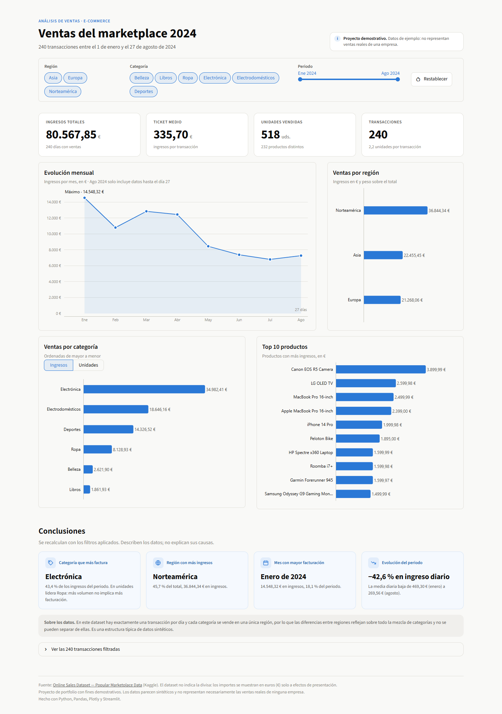

# Análisis de ventas de un e-commerce (2024)

Dashboard interactivo en **Python + Pandas + Streamlit** para explorar las ventas de un marketplace online: indicadores principales, evolución mensual, ventas por región, categoría y producto, y conclusiones que se recalculan con los filtros.

<p align="center">
  <a href="https://franciss009.github.io/ecommerce-sales-analysis/">
    
  </a>
</p>

<h2 align="center">
  👉 <a href="https://franciss009.github.io/ecommerce-sales-analysis/">Ver el dashboard en vivo</a>
</h2>

<p align="center"><sub>Se abre en el navegador, sin instalar nada. La primera carga tarda unos 30 segundos: Python se ejecuta dentro de tu navegador.</sub></p>

> **Proyecto demostrativo.** El dataset es público y parece **sintético**: las cifras no representan ventas reales de ninguna empresa (ver [Limitaciones](#limitaciones)).

[](https://franciss009.github.io/ecommerce-sales-analysis/)

---

## Objetivo

Practicar un flujo completo de análisis de datos con un dataset descargado de internet:

1. Revisar la calidad del CSV y preparar una versión limpia.
2. Calcular indicadores de negocio con funciones reutilizables de Pandas.
3. Presentar los resultados en un dashboard interactivo, claro y responsive.
4. Interpretar los datos con prudencia, distinguiendo lo que muestran de lo que no pueden explicar.

## Dataset

| | |
|---|---|
| **Nombre** | Online Sales Dataset — Popular Marketplace Data |
| **Fuente** | [Kaggle](https://www.kaggle.com/datasets/shreyanshverma27/online-sales-dataset-popular-marketplace-data) |
| **Licencia** | CC0: Public Domain |
| **Tamaño** | 240 transacciones × 9 columnas |
| **Periodo** | 1 de enero – 27 de agosto de 2024 |

Columnas: `Transaction ID`, `Date`, `Product Category`, `Product Name`, `Units Sold`, `Unit Price`, `Total Revenue`, `Region` y `Payment Method`.

**Moneda.** La fuente no indica la divisa de los importes. En el dashboard se muestran en euros (€) **por convención de presentación**: los valores no se han convertido ni modificado.

## Herramientas

- **Python** — lenguaje del proyecto.
- **Pandas** — lectura, limpieza, agregaciones y fechas.
- **Streamlit** — interfaz web del dashboard y filtros.
- **Plotly** — gráficos interactivos con tooltips.
- **stlite + GitHub Pages** — versión web: ejecuta la misma app de Streamlit en el navegador (Pyodide), sin servidor.

## Estructura del proyecto

```text
ecommerce-sales-analysis/
├── app.py                  # Dashboard de Streamlit (punto de entrada)
├── index.html              # Versión web (stlite): carga app.py en el navegador
├── src/
│   ├── lectura.py          # leer_csv(): carga el CSV con control de errores
│   ├── limpieza.py         # Revisión de calidad y generación del CSV limpio
│   ├── calculos.py         # KPIs y agregaciones (región, categoría, mes, producto)
│   ├── graficos.py         # Gráficos Plotly con estilo común
│   └── main.py             # Informe de resultados por terminal
├── data/
│   ├── online_sales_raw.csv    # Dataset original
│   └── online_sales_clean.csv  # Dataset preparado (lo usa el dashboard)
├── assets/                 # Capturas del README
├── .streamlit/config.toml  # Tema visual del dashboard
└── requirements.txt
```

El dashboard **reutiliza** las funciones de `src/calculos.py`: los filtros se aplican al DataFrame antes de llamarlas, por lo que todas las métricas, gráficos y conclusiones se calculan sobre los datos filtrados.

## Preparación de los datos

`src/limpieza.py` revisa el CSV original y guarda la versión limpia:

- **Formato:** la transacción `10016` tenía un nombre de producto con comas (_"Salt, Fat, Acid, Heat…"_) que desplazaba las columnas al leer el CSV. Se corrigió entrecomillando ese campo en el archivo original.
- **Valores nulos:** 0 en todas las columnas.
- **Duplicados:** 0 filas duplicadas y 0 identificadores de transacción repetidos.
- **Coherencia de importes:** se comprueba que `Units Sold × Unit Price = Total Revenue`; no hay ninguna transacción con importes incorrectos.
- **Resultado:** `data/online_sales_clean.csv`, con las mismas 240 filas y los importes en formato numérico homogéneo.

## KPIs

| Indicador | Cálculo |
|---|---|
| **Ingresos totales** | Suma de `Total Revenue` |
| **Ticket medio** | Ingresos totales ÷ número de transacciones |
| **Unidades vendidas** | Suma de `Units Sold` |
| **Transacciones** | Número de `Transaction ID` distintos |

## Visualizaciones

- **Filtros:** región, categoría y rango de meses, con botón para restablecerlos.
- **Evolución mensual:** ingresos por mes, con el máximo destacado y aviso de que agosto está incompleto (datos hasta el día 27).
- **Ventas por región:** ingresos y peso sobre el total.
- **Ventas por categoría:** alternando entre ingresos y unidades, para ver que más volumen no implica más facturación.
- **Top 10 productos** por ingresos.
- **Conclusiones automáticas:** categoría y región líderes, mes con mayor facturación y variación del ingreso diario medio entre el primer y el último mes (comparar la media diaria evita penalizar a un mes incompleto).
- **Tabla** con las transacciones filtradas.

El diseño es responsive: en móvil los bloques se apilan en una sola columna. Un interruptor en la cabecera activa el **modo oscuro**, que adapta también los gráficos y la tabla.

## Limitaciones

- **Datos sintéticos.** Hay exactamente una transacción por día y cada categoría se vende en una única región. Son patrones típicos de datos generados, no de un marketplace real.
- **Región y categoría están mezcladas.** Como cada categoría pertenece a una sola región, las diferencias entre regiones reflejan sobre todo la mezcla de categorías y no se pueden separar de ellas.
- **Periodo parcial.** Solo hay datos hasta el 27 de agosto de 2024: no permite conclusiones anuales ni estacionales.
- **Muestra pequeña.** 240 transacciones: los resultados describen el dataset, pero no explican sus causas.
- **Moneda no especificada** en la fuente (ver [Dataset](#dataset)).

## Cómo ejecutarlo

Requisitos: Python 3.11 o superior.

```bash
git clone https://github.com/franciss009/ecommerce-sales-analysis.git
cd ecommerce-sales-analysis
python -m venv .venv
# Windows: .venv\Scripts\activate    ·    macOS/Linux: source .venv/bin/activate
pip install -r requirements.txt

# Dashboard (se abre en http://localhost:8501)
streamlit run app.py

# Opcional: informe de resultados por terminal
python src/main.py

# Opcional: regenerar el CSV limpio a partir del original
python src/limpieza.py
```

## Autor

Proyecto de portfolio desarrollado por [franciss009](https://github.com/franciss009) como práctica de análisis de datos con Python.
